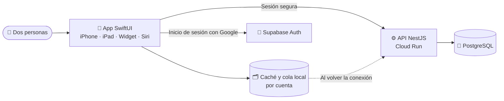

# 🏡 OurSpace

### *Un rincón privado en el iPhone para dos personas.*

**Tareas · Calendario · Deseos · Viajes · Misiones · Una pregunta cada día**

---

## 💌 ¿Qué es OurSpace?

La mayoría de las apps de pareja intentan ser una red social. **OurSpace no.**
Es un espacio **privado, compartido por exactamente dos personas**, donde caben las
pequeñas cosas que sostienen una relación: quién saca la basura, cuándo es esa cena,
qué lugar quedó pendiente en la lista, qué se acordó hace tres meses y qué viaje viene después.

Sin feed, sin likes, sin anuncios, sin clasificaciones sobre quién aporta más.
Solo ustedes, un calendario compartido y las ganas de hacer cosas juntos.

> *«Lo que construimos entre dos merece un lugar propio.»*

---

## ✨ Lo que hacemos

| | |
|---|---|
| 🌤️ **Hoy** | Días juntos, tareas del día, la pregunta diaria, un dato curioso y su misión en curso, en una sola pantalla. |
| ✅ **Tareas** | Para una persona o para las dos, con recordatorios y orden a mano. |
| 📅 **Calendario** | Eventos y **fechas que no se olvidan**, con un empujoncito amable de **«Tiempo para una cita»** y una biblioteca de ideas para planear. |
| 🧳 **Viajes** | Un mapamundi con un pin por cada ciudad: lo que ya visitaron, lo que viven ahora y lo que sueñan. Funciona sin conexión. |
| 🎁 **Deseos** | Listas compartidas de cosas por hacer, comprar o probar. Incluso se pueden importar desde Google Keep. |
| 🎯 **Misiones y Desafíos** | Metas que se cumplen juntos, con aportes sin rankings ni ganadores, y un reto amistoso si les apetece. |
| 🌱 **Pequeños momentos** | Una práctica diaria breve para cuidar el vínculo, con pausas y recordatorios a su ritmo. |
| 🗳️ **Decidir juntos** | Listas de opciones para dejar de responder «¿qué quieres tú?». |
| 🤝 **Acuerdos** | Lo que se prometieron, escrito y con responsables. |
| 💬 **Pregunta del día** | Una pregunta que cada quien responde por su cuenta para conocerse un poco más. |
| 🪄 **Widget, Siri y Spotlight** | «Oye Siri, crea una tarea en OurSpace». También desde la pantalla de inicio y desde la búsqueda del iPhone. |

Y si algo no les sirve, lo **apagan**: cada función se puede ocultar desde Perfil.

---

## 🧭 Cómo pensamos

**🔒 Privacidad ante todo.** Los datos son de dos personas y de nadie más. Hay cosas que
se quedan solo en el teléfono de quien las escribe y cumplir algo nunca se comparte sin
que se elija. Los avisos locales no repiten títulos privados. El widget solo recibe una
copia mínima de lo necesario.

**📶 Offline-first de verdad.** Si no hay internet, la app funciona igual: todo cambio se
guarda primero en el teléfono, entra en una cola durable y viaja al servidor cuando se
puede, con claves idempotentes para no duplicar nada. Nunca se anuncia «sincronizado»
antes de que sea cierto.

**🫶 Cero presión.** Sin rachas que castigan, sin puntajes entre ustedes, sin culpas.
Las pausas son una función, no un fallo. Los textos hablan con un tono neutral y amable.

**♿ Hecha para todos.** Texto dinámico, VoiceOver, áreas táctiles amplias y un sistema
de diseño único para que cada pantalla se sienta como la misma app, también en iPad.

**🧪 Se prueba en serio.** Pruebas automáticas en cada cambio, reporte de resultados y
medición de cobertura. Un cambio solo entra a `main` por pull request y con el CI en verde.

---

## 🛠️ Por dentro

| Pieza | Tecnología |
|---|---|
| App | Swift 5, SwiftUI, WidgetKit, App Intents, CoreSpotlight, UserNotifications |
| Identidad | Supabase Auth, Keychain |
| Servidor | NestJS, TypeORM, contrato OpenAPI como fuente de verdad |
| Datos | PostgreSQL |
| Infraestructura | Google Cloud Run, con el gasto vigilado de cerca |
| Calidad | Pruebas automáticas, cobertura de código, CI en GitHub Actions |

---

## 📦 Repositorios

| Repositorio | Qué contiene |
|---|---|
| **[`ourspace`](https://github.com/ourspace-pj/ourspace)** 📱 | La app para iPhone y iPad, el widget y las extensiones. |
| **[`ourspace-api`](https://github.com/ourspace-pj/ourspace-api)** ⚙️ | La API privada y el contrato OpenAPI. |

> 🔐 Los repositorios son privados: el código es de la casa, igual que el espacio de cada pareja.

---

## 🌍 Hecho por una colombiana  y un chileno , con cariño

OurSpace nació como un proyecto para **Paola y Juan**, y creció pensando en que cualquier pareja
pueda tener un lugar tranquilo donde organizar su vida en común.

*Dos personas. Un espacio. Muchas cosas por hacer juntos.* 💛

